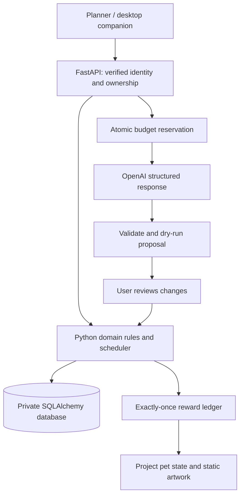

# Pawgress architecture

## Source map

- `app/main.py`: routes, input validation, identity, ownership, proposal lifecycle, focus and admin controls.
- `app/domain.py`: scheduling, project slots, task dependencies, growth and reward rules.
- `app/database.py`: transactional private user documents, settings and usage ledger.
- `app/ai.py`: bounded model requests, pricing allowlist, budget reservations, schemas and instructions.
- `app/static/`: responsive browser UI and reusable artwork; no runtime frontend build or CDN dependency.
- `desktop/`: sandboxed Electron shell and narrow preload IPC bridge.
- `tests/`: deterministic automated safety and behavior tests.
- `evals/`: ten human-readable scenarios and an opt-in paid evaluation runner.

## Data and transactions

One user row contains a JSON document with projects, project pets, task tombstones, immutable reward records, focus history, explicit memories, chat, proposals and change history. This intentionally small model is appropriate for the initial pilot; normalize tables before larger-scale analytics or collaboration.

SQLite uses `BEGIN IMMEDIATE`; Postgres uses row locks for mutations. The three-slot check and creation share the same transaction. Version numbers reject stale edits and approvals. A singleton locked budget row serializes reservation checks; every reservation is durably recorded before contacting a model. Spend is in integer microdollars, grouped by UTC calendar month. Output caps and conservative input-byte bounds reserve worst-case token cost. Actual reported usage releases the excess; timeouts retain reservations because a remote request may have run. No automatic retry is performed.

The budget ledger covers only this backend's calls and documented model pricing, not taxes, external API-key usage or hosting. A provider-side cap is a second layer. New models fail closed until pricing is added. Price assumptions must be reviewed before release.

## Auth and secrets

Production verifies each bearer token with Supabase `/auth/v1/user` and requires a verified email. All application operations then load only that user's document. Disabled accounts are rejected even with a valid token. Administrator access uses a server-controlled email allowlist, never client-editable metadata. No password is stored in the application database or exposed through an admin route.

Supabase Auth owns password handling; the backend proxies sign-in/signup/reset over HTTPS without persisting or logging credentials. Session tokens are persisted in the browser/Electron origin storage for login continuity; restrictive CSP and escaped rendering protect the surface. No arbitrary HTML/Markdown from model or user data is rendered.

Use private Postgres credentials for the backend. Startup enables RLS and revokes table access from PUBLIC and Supabase `anon`/`authenticated` roles. The application connection must own these private tables; it enforces ownership itself. The Supabase Data API must not expose this document store to clients. Do not put database credentials or an OpenAI key into Electron or browser code.

## Agent behavior

A structured response contains `reply`, one allowlisted `action`, `target_id`, and `value`. Backend handlers act as controlled tools. The model has no direct DB, filesystem, network tools or reward-write capability. Mutations are validated and dry-run against a copy, then stored pending review. The UI lists changed fields/dates. Approval rechecks identity, project status and version before applying the same function used for direct edits. The agent cannot approve its own proposal.

Supported writes: complete/reopen/rename/delete/add task, rename project, exact deadline change, explicit unavailable dates, archive/trash project, and explicitly requested memory. More detailed changes use the manual editor. No generic code execution, unrestricted SQL, or autonomous multi-step agent is included.

## Desktop boundary

Electron loads only the configured HTTPS origin (or loopback for local use). Renderer Node integration is off; sandbox and context isolation are on; navigation, new windows and permissions are restricted. The bridge exposes only opening the companion or planner. Both windows share the same origin/session. No signed installer, auto-update service or background system daemon is included.
